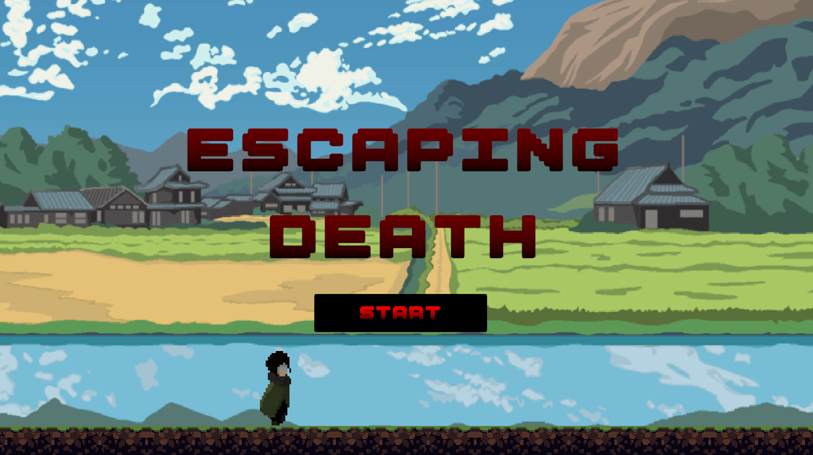
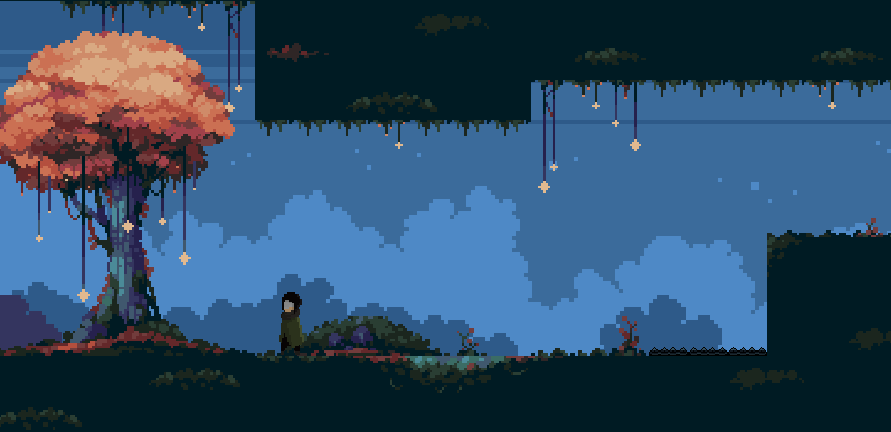
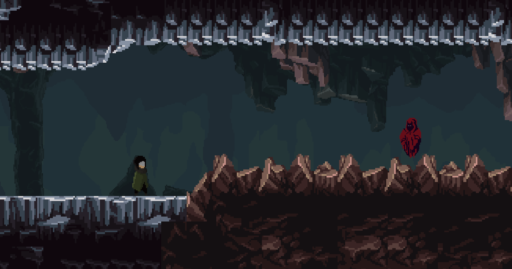

# SebastianZadomen_RA3

## Escaping Death
Escaping Death és un joc de plataformes en 2D desenvolupat en Unity. La història segueix a un heroi que mentre deambula, es troba amb un portal i entra sense pensar-lo, quedant atrapat en diferents escenaris dels quals haurà d'escapar superant obstacles i enemics.

## Controls

* **A / D :** Moure's
* **Space:** Canviar la gravetat
* **Q:** Fer dash
* **Esc:** Obrir el menú d'opcions

## Visualitzacions

